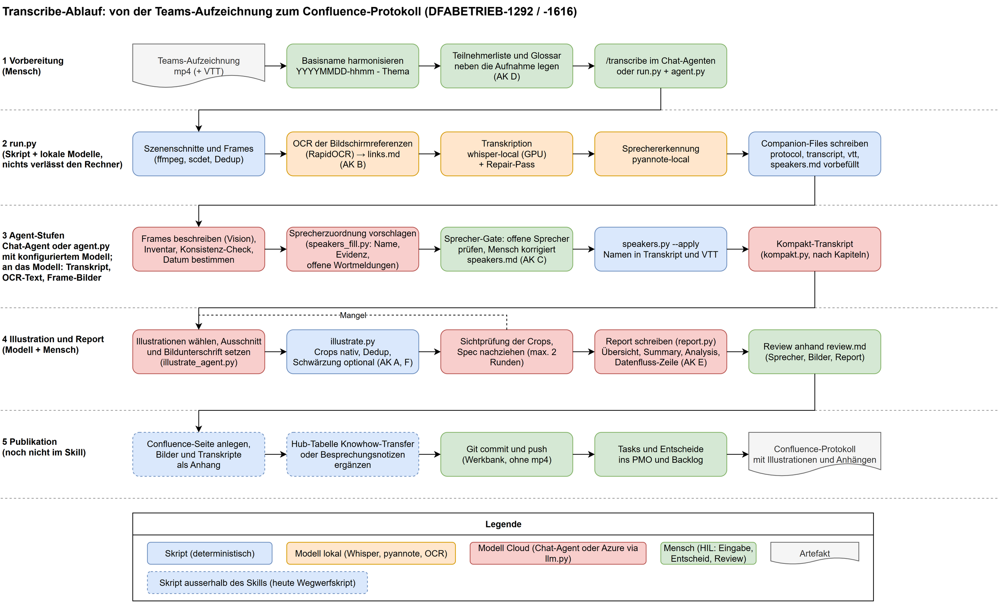

# Transcribe operationalisieren und im Team bereitstellen

Mit `/transcribe` lassen sich Video- und Audio-Aufnahmen transkribieren und auswerten. Der Skill kombiniert Python-Skripte mit einer modellgestützten Auswertung. Die Auswertung macht entweder der Chat-Agent, der den Skill ausführt, oder das Skript `agent.py` mit einem konfigurierten Modell-Endpunkt. Danach prüft ein Mensch den Bericht.

## 1. Betriebsmodell

**Empfehlung:** Einen geprüften Stand der AI-Toolbox bereitstellen, pro Arbeitsplatz lokal installieren und im Arbeitsprojekt verknüpfen. Aufnahmen und Ergebnisse bleiben in einem dafür freigegebenen Arbeitsverzeichnis.

| Bestandteil | Bereitstellung |
|---|---|
| Skill und Skripte | AI-Toolbox, Unterverzeichnis `.agents\skills\transcribe` |
| Version | Vom Verantwortlichen getestete und veröffentlichte Commit-ID |
| Team-Anleitung | Diese Seite, bei Bedarf nach Confluence spiegeln |
| Python, Werkzeuge und Modelle | Je Arbeitsplatz; einmaliges Setup |
| Modell-Endpunkt für die Auswertung | Freigegebenes Azure-Deployment, je Arbeitsplatz in `%USERPROFILE%\.config\transcribe\.env` |
| Zugangsdaten | Nur lokal, niemals im Git-Repo oder Installationspaket |
| Aufnahme, Transkript und Bericht | Freigegebener Ablageort mit passenden Zugriffsrechten |

Jeder Arbeitsplatz braucht einen eigenen Checkout und eine lokale Verknüpfung. Updates des Checkouts werden sofort durch die Verknüpfung sichtbar. Deshalb einen getesteten Versionsstand verwenden.

## 2. Voraussetzungen und Datenschutz

- Windows, PowerShell, Git und ein lauffähiges Python mit dem Befehl `python`.
- Für die Auswertung eines von zwei Wegen:
  - **Kommandozeile (empfohlen für Copilot):** Ein freigegebenes Azure-OpenAI-Chat-Deployment mit Text- und Bildeingabe, beispielsweise `gpt-6.1-sol`. Ein Chat-Agent ist dafür nicht nötig.
  - **Interaktiv:** Ein Agent mit Skill-Unterstützung, beispielsweise Claude Code oder Copilot in VS Code. Das Ausführen lokaler Skripte sowie das Lesen von Text und Bildern muss erlaubt sein.
- Genügend Speicher und Zeit für Modelle und Aufnahmen. CPU-Betrieb ist möglich, eine geeignete GPU kann beschleunigen. Laufzeiten am eigenen Testfall messen.
- Freigegebene Downloadwege für Werkzeuge, Python-Pakete und Modelle.
- Berechtigung zum Verarbeiten der Aufnahme sowie ein geklärter Ablage- und Löschprozess.

**Datenfluss:** `run.py` arbeitet lokal: Frames, OCR, Whisper und Sprechertrennung laufen auf dem Rechner. Die Auswertung erhält Transkripttext, OCR-Text, die Sprechertabelle, Frame-Bilder und Bildausschnitte. Audio und Video gehen nicht an das Modell. Dafür darf nur ein für die Informationsklassifikation freigegebener Agent- bzw. Modell-Endpunkt genutzt werden. Jeder Bericht von `agent.py` nennt in der Zeile «Datenfluss» das verwendete Modell und was es erhalten hat. Auch Zusammenfassungen, OCR-Ausgaben und Sprecherdateien enthalten vertrauliche Daten.

Das Schwärzen von Personendaten in den Bildausschnitten ist optional und standardmässig aus. Mit `pipeline.py --redact` gilt es für einen Lauf, mit `TRANSCRIBE_REDACT=1` in der `.env` als Standard. Auf einem fertigen Lauf ergänzt `--redact` nur die Schwärzung; Auswahl und Bildunterschriften bleiben. `--no-redact` nimmt sie wieder weg. Einschalten, wenn Bilder an einen grösseren Kreis gehen als die Aufnahme selbst.

Die Standard-Pipeline kann bei konfigurierten Zugangsdaten auf Cloud-Backends ausweichen. Für einen ausdrücklich lokalen Lauf `--whisper whisper-local` setzen und entweder `--no-diarize` oder explizit `--diarize pyannote-local` verwenden. Damit ist kein Cloud-Fallback für diese beiden Stufen vorgesehen. Lokale Sprechertrennung braucht zusätzlich die passenden Modellrechte und einen Hugging-Face-Token. Für den ersten Test ist sie nicht erforderlich.

## 3. Installation auf einem weiteren Windows-Arbeitsplatz

Der Verantwortliche liefert vorab:

1. Den freigegebenen Git-Repository-Zugang. Die im Skill genannte Upstream-Quelle ist `https://github.com/danielfrey63/ai-toolbox`. Alternativ einen freigegebenen internen Mirror nutzen.
2. Die vollständige, getestete Commit-ID.
3. Den freigegebenen Agent-Endpunkt und Ablageort.

Folgenden Block in PowerShell ausführen. Der Checkout-Pfad ist frei wählbar und muss absolut sein. Einen dedizierten Checkout für den Skill verwenden. Ein erneuter Lauf behält den passenden Checkout und die passende Verknüpfung bei. Abweichende Ziele oder lokale Änderungen werden gemeldet.

```powershell
$ErrorActionPreference = 'Stop'
$Repository = Read-Host 'Approved AI-Toolbox Git URL'
$Version = Read-Host 'Approved full commit ID'
$Checkout = Read-Host 'Absolute path for the dedicated AI-Toolbox checkout'
$Project = Read-Host 'Absolute path of the working project'

if ($Version -notmatch '^[0-9a-fA-F]{40}$') {
    throw 'A full commit ID is required.'
}
if (-not [System.IO.Path]::IsPathRooted($Checkout)) {
    throw 'The checkout path must be absolute.'
}
if (-not [System.IO.Path]::IsPathRooted($Project) -or
    -not (Test-Path -LiteralPath $Project -PathType Container)) {
    throw 'The working project must be an existing absolute directory.'
}

if (-not (Test-Path -LiteralPath $Checkout)) {
    New-Item -ItemType Directory -Path (Split-Path $Checkout -Parent) -Force | Out-Null
    git clone -- $Repository $Checkout
    if ($LASTEXITCODE -ne 0) { throw 'Git clone failed.' }
}
if (-not (Test-Path -LiteralPath (Join-Path $Checkout '.git') -PathType Container)) {
    throw 'The checkout path is not a dedicated Git clone.'
}
$Origin = git -C $Checkout remote get-url origin
if ($LASTEXITCODE -ne 0 -or $Origin -ne $Repository) {
    throw 'The existing checkout does not use the requested repository URL.'
}
$CurrentVersion = git -C $Checkout rev-parse HEAD
if ($LASTEXITCODE -ne 0) { throw 'Cannot determine the installed version.' }
if ($CurrentVersion -ne $Version) {
    $Changes = git -C $Checkout status --porcelain
    if ($LASTEXITCODE -ne 0) { throw 'Cannot check local changes.' }
    if ($Changes) { throw 'Local changes exist. Resolve them before switching versions.' }
    git -C $Checkout fetch origin
    if ($LASTEXITCODE -ne 0) { throw 'Git fetch failed.' }
    git -C $Checkout checkout --detach $Version
    if ($LASTEXITCODE -ne 0) { throw 'The approved version is not available.' }
}

$Skill = Join-Path $Checkout '.agents\skills\transcribe'
if (-not (Test-Path -LiteralPath (Join-Path $Skill 'SKILL.md') -PathType Leaf)) {
    throw 'SKILL.md is missing at the expected location.'
}
$SkillParent = Join-Path $Project '.claude\skills'
New-Item -ItemType Directory -Path $SkillParent -Force | Out-Null
$Link = Join-Path $SkillParent 'transcribe'
if (Test-Path -LiteralPath $Link) {
    $ExistingLink = Get-Item -LiteralPath $Link -Force
    if ($ExistingLink.LinkType -ne 'Junction' -or
        [System.IO.Path]::GetFullPath([string]$ExistingLink.Target) -ne
        [System.IO.Path]::GetFullPath($Skill)) {
        throw 'The skill destination exists and does not match the requested junction.'
    }
} else {
    New-Item -ItemType Junction -Path $Link -Target $Skill | Out-Null
}
Get-Item -LiteralPath $Link | Select-Object FullName, LinkType, Target
```

In einem Git-Arbeitsprojekt die Zeile `/.claude/skills/transcribe` in die Projekt-Ignore-Datei aufnehmen. Die Junction nicht committen.

Falls die Firmenrichtlinie Junctions verbietet, einen kuratierten Release-Ordner mit `SKILL.md`, `scripts`, `references` und erforderlichen Ressourcen als echte Dateien verteilen. Keine `.env`, virtuellen Umgebungen, Caches, Medien oder Konfliktkopien mitliefern. Kopien brauchen einen expliziten Update-Prozess.

### Agent-Erkennung

- VS Code bzw. die Agent-Sitzung neu laden und prüfen, ob `/transcribe` angeboten wird.
- Bei fehlender Erkennung zuerst den Projektpfad und die Erreichbarkeit von `.claude\skills\transcribe\SKILL.md` prüfen.
- `SKILL.md` verwendet `${CLAUDE_SKILL_DIR}` für den Skill-Ordner. Claude Code setzt die Variable, Copilot nicht. `SKILL.md` weist andere Agenten an, stattdessen den absoluten Pfad des Ordners zu nehmen. Die Skripte selbst hängen von keinem Agenten ab.
- Ist ein Modell-Endpunkt konfiguriert (Abschnitt 4), soll der Agent die Auswertung an `agent.py` übergeben und danach aus den erzeugten Dateien antworten. So hängt das Ergebnis nicht vom Modell des Agenten ab.
- Ein sichtbarer Slash-Befehl belegt die Erkennung. Der Abnahmetest prüft zusätzlich die Python-Pipeline und die Auswertung.

## 4. Laufzeit vorbereiten

In einer neuen PowerShell den Projektpfad setzen:

```powershell
$Project = Read-Host 'Absolute path of the working project'
$Skill = Join-Path $Project '.claude\skills\transcribe'
python (Join-Path $Skill 'scripts\setup.py') --check
$CheckExit = $LASTEXITCODE
```

| Exit-Code | Bedeutung | Nächster Schritt |
|---|---|---|
| `0` | Ein Transkriptionsweg ist verfügbar | Für lokalen Betrieb zusätzlich `local_venv.ready` prüfen |
| `2` | Werkzeuge fehlen | `python (Join-Path $Skill 'scripts\setup.py')` |
| `3` | Kein Transkriptionsweg | `python (Join-Path $Skill 'scripts\setup.py') --venv` |
| `4` | Werkzeuge und Transkriptionsweg fehlen | `python (Join-Path $Skill 'scripts\setup.py')` |
| andere | Unerwarteter Fehler | Fehlermeldung klären, nicht als erfolgreich behandeln |

Nach einem erforderlichen Setup erneut `--check` ausführen und Exit `0` verlangen. Mit folgendem Aufruf den lokalen Zustand kontrollieren:

```powershell
python (Join-Path $Skill 'scripts\setup.py') --json
```

Für den lokalen Betriebsweg muss `local_venv.ready` wahr sein. Ein vorhandener Cloud-Key allein kann ebenfalls einen erfolgreichen allgemeinen Check erzeugen. Falls die lokale Umgebung fehlt, `setup.py --venv` ausführen und erneut prüfen.

Unter Windows legt der Installer Werkzeuge unter `%USERPROFILE%\.transcribe\bin` und die verwaltete ML-Umgebung unter `%USERPROFILE%\.config\transcribe\venv` ab. Der Installer kann Downloads und eine lokale Konfigurationsdatei anlegen. Keine API-Keys von anderen Arbeitsplätzen übernehmen.

### Modell-Endpunkt für die Auswertung

Für den Weg über die Kommandozeile das freigegebene Chat-Deployment in `%USERPROFILE%\.config\transcribe\.env` eintragen. Der Endpunkt ist die Basis-URL der Ressource ohne Deployment-Pfad, das Modell ist der Deployment-Name. Alle weiteren Schlüssel stehen kommentiert in `.env.example`.

```
AZURE_LLM_ENDPOINT=https://<resource>.openai.azure.com
AZURE_LLM_KEY=<key>
AZURE_LLM_MODEL=gpt-6.1-sol
```

Der Chat-Endpunkt ist getrennt von einem allfälligen Transkriptions-Endpunkt (`AZURE_TRANSCRIBE_DIARIZE_URL`) und hat einen eigenen Key. Danach prüfen, ob das Deployment Text und Bilder beantwortet:

```powershell
python (Join-Path $Skill 'scripts\llm.py') --probe --image <Pfad zu einem PNG>
```

Am Testfall hat `gpt-6.1-sol` Bildschirminhalte zuverlässiger gelesen als `gpt-6-luna`. Deshalb ist `gpt-6.1-sol` der Standard.

## 5. Abnahme und regulärer Ablauf

### Ablaufdiagramm



[Diagramm in Draw.io bearbeiten](./transcribe-ablauf.drawio)

Das Diagramm zeigt den SBB-Ablauf mit lokalen Transkriptions- und Sprecher-Modellen, anschliessender Auswertung im Chat-Agenten oder über `agent.py`, Sprecher-Gate, Review anhand `review.md` und Publikation in Confluence. Die lokale Stufe setzt explizit lokale Backends voraus. Confluence-Publikation und PMO-Übernahme sind nachgelagerte Schritte und noch nicht Teil des Skills.

### Abnahmetest

Eine kurze, unkritische Testaufnahme mit bekanntem Inhalt und einheitlichem Namen bereitstellen, beispielsweise `20261013-1100 - Transcribe Test.m4a`.

1. `setup.py --check` liefert Exit `0`; der lokale Venv ist bereit.
2. Die Aufnahme explizit lokal und ohne Sprechertrennung verarbeiten:

   ```powershell
   $Recording = Read-Host 'Absolute path of the non-sensitive test recording'
   python (Join-Path $Skill 'scripts\pipeline.py') $Recording --language de --local --no-diarize
   if ($LASTEXITCODE -ne 0) { throw "Test run failed (exit $LASTEXITCODE)." }
   ```

   `pipeline.py` prüft das Setup, führt die lokalen Stufen (`run.py`) und danach die Auswertung (`agent.py`) aus. Exit `1` heisst, dass `run.py` fehlgeschlagen ist, Exit `2`, dass das Setup unvollständig ist, Exit `3`, dass kein Modell-Endpunkt konfiguriert ist. Exit `4` heisst, dass der Lauf am Sprecher-Gate angehalten hat (`--stop-at-speakers`). Ein erneuter Aufruf überspringt fertige Stufen und setzt fort.
3. Im Protokoll die tatsächliche Transkriptionsquelle kontrollieren. Ausgabe und Transkript müssen zur Aufnahme passen und plausible Zeitstempel haben.
4. Die Meldungen von `pipeline.py` auf übersprungene oder fehlgeschlagene Stufen durchsehen.
5. Der Bericht `<base>.md` enthält `Übersicht`, `Summary`, `Analysis` und die Zeile «Datenfluss». `<base>.review.md` listet die Punkte, die ein Mensch vor der Weitergabe prüft.
6. Optional zusätzlich einen Agent-Test über `/transcribe` mit derselben Aufnahme durchführen. Explizit lokale Transkription und keine Sprechertrennung verlangen. Der Agent liest die Pflichtreferenz `references\report-writing.md` oder übergibt an `pipeline.py`.
7. Mindestens einen bekannten Satz und seine Zeitposition manuell vergleichen. Bei Video zusätzlich einen bekannten Bildschirminhalt prüfen.
8. Commit-ID, Rechner/CPU/GPU, Modell-Endpunkt und Deployment, Dauer, verwendetes Backend und Ergebnis der manuellen Kontrolle im Freigabenachweis festhalten.

Erst danach den Stand für andere freigeben. Sprechertrennung und OCR bei Bedarf in einem zweiten Test gesondert abnehmen.

### Regulärer Ablauf

1. Berechtigung, Klassifikation, Agent-Endpunkt und Ablageort prüfen.
2. Aufnahme nach `YYYYMMDD-hhmm - Thema` benennen. Datum und Teilnehmer kontrollieren; Dateimetadaten sind nur Hinweise.
3. Optional Glossar und Teilnehmerliste neben die Aufnahme legen: Fachbegriffe bzw. `Name - Rolle` je Zeile. Pro Aufnahme heissen sie `<Name>.glossary.txt` und `<Name>.participants.txt`, für alle Aufnahmen im Ordner `transcribe-glossary.txt` und `transcribe-participants.txt`. Die Datei pro Aufnahme hat Vorrang. `run.py` und `agent.py` melden zu Beginn, welche Datei sie gefunden haben.
4. Entweder `pipeline.py` mit absolutem Aufnahmepfad, Sprache und `--local` aufrufen, oder `/transcribe` im Agenten mit Aufnahmepfad, Sprache und gewünschter Fragestellung. Für vertrauliche Aufnahmen lokale Backends ausdrücklich festlegen (`--local`).
5. Bei mehreren Sprechern `pipeline.py … --stop-at-speakers` verwenden, die offenen Zuordnungen in `speakers.md` prüfen und korrigieren, dann denselben Befehl ohne `--stop-at-speakers` erneut aufrufen.
6. Bericht und Transkript anhand `review.md` prüfen: Eigennamen, Zahlen, Sprecher, Bildausschnitte, Entscheidungen und Aufgaben nicht ungeprüft übernehmen. Unsicherheiten kennzeichnen.
7. Publizieren: In `<base>.review.md` jede Box ankreuzen, die geprüft ist, dann `publish.py <base> --dry-run` und `publish.py <base>`. Das Ziel steht in `transcribe-publish.txt` (Ordner) bzw. `<Name>.publish.txt` (Aufnahme) oder kommt mit `--parent ID`. Ändert sich ein geprüftes Artefakt danach, öffnet sich seine Box wieder, und `publish.py` lädt nichts hoch.
8. Nur die geprüften Ergebnisse an die berechtigten Empfänger weitergeben. Rohaufnahme, Transkript und temporäre Bilder gemäss Aufbewahrungsregel behandeln.

Wichtige Begleitdateien liegen standardmässig neben der lokalen Aufnahme: `.protocol.md`, `.transcript.md`, der Bericht `.md` und `.review.md`. Bei Sprechertrennung kommen `.speakers.md` und das modellgeschriebene `.transcript-kompakt.md` hinzu. Video/OCR erzeugt zusätzlich `.frames.json` und die Illustrationen unter `.illustrations\`.

Im SBB-Kontext gehen Aufgaben und Entscheidungen anschliessend ins bereichsübergreifende persönliche PMO: Datum, Gruppe, Medium, Von und An prüfen, Protokoll mit `org: sbb` und `gruppe:` anlegen, Aufgaben als `TASK:`-Zeilen erfassen und über die PMO-CLI ingestieren. Fehlende Pflichtfelder zuerst klären. Die Task-Dateien nicht direkt editieren.

## 6. Updates, Support und Rollback

**Verantwortlicher:** Einen Skill-Verantwortlichen und eine Stellvertretung benennen. Sie pflegen Quelle, Freigabe-Commit, Testnachweis, bekannte Einschränkungen und Installationshinweise. Diese Rollen sind noch zu besetzen.

Vor einem Update die bisherige Commit-ID mit `git -C $Checkout rev-parse HEAD` notieren. Der folgende Block prüft lokale Änderungen und wechselt bei Bedarf auf den freigegebenen Stand. Bei Änderungen stoppen und deren Herkunft klären.

```powershell
$ErrorActionPreference = 'Stop'
$Checkout = Read-Host 'Absolute path of the dedicated AI-Toolbox checkout'
$Version = Read-Host 'New approved full commit ID'
if ($Version -notmatch '^[0-9a-fA-F]{40}$') {
    throw 'A full commit ID is required.'
}
if (-not [System.IO.Path]::IsPathRooted($Checkout) -or
    -not (Test-Path -LiteralPath (Join-Path $Checkout '.git') -PathType Container)) {
    throw 'The checkout path must point to a dedicated Git clone.'
}
$Changes = git -C $Checkout status --porcelain
if ($LASTEXITCODE -ne 0) { throw 'Cannot check local changes.' }
if ($Changes) { throw 'Local changes exist. Resolve them before updating.' }
$CurrentVersion = git -C $Checkout rev-parse HEAD
if ($LASTEXITCODE -ne 0) { throw 'Cannot determine the installed version.' }
if ($CurrentVersion -ne $Version) {
    git -C $Checkout fetch origin
    if ($LASTEXITCODE -ne 0) { throw 'Git fetch failed.' }
    git -C $Checkout checkout --detach $Version
    if ($LASTEXITCODE -ne 0) { throw 'Version change failed.' }
}
```

Danach Setup-Check und Abnahmetest wiederholen und die Agent-Sitzung neu laden. Rollback des Skill-Codes: Auf die zuvor notierte Commit-ID wechseln. Bereits geänderte Modelle, Werkzeuge oder virtuelle Umgebungen bleiben dabei bestehen. Den Setup-Zustand separat prüfen.

Für Support nur freigegebene, bereinigte Diagnosen weitergeben: Commit-ID, Betriebssystem, Backend, Exit-Code und konkrete Fehlermeldung. Keine Keys, Rohaufnahmen oder vertraulichen Transkripte in öffentliche Issues hochladen.

## 7. Vor dem Team-Rollout noch festzulegen

- Verantwortlicher und Stellvertretung.
- Freigegebene Quelle bzw. interner Mirror und getestete Commit-ID.
- Zulässige Informationsklassifikation und Agent- bzw. Modell-Endpunkt, inklusive Azure-Deployment für `agent.py`.
- Ob das Schwärzen von Personendaten in den Bildausschnitten Standard ist (`TRANSCRIBE_REDACT`).
- Ablage, Zugriffsrechte und Aufbewahrungs-/Löschfristen.
- Pilotanwender, Testaufnahme und Freigabenachweis.
- Ob Sprechertrennung und OCR zum verpflichtenden Funktionsumfang gehören.
